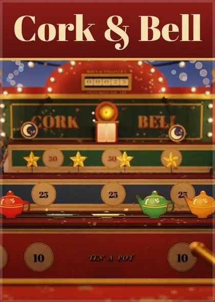
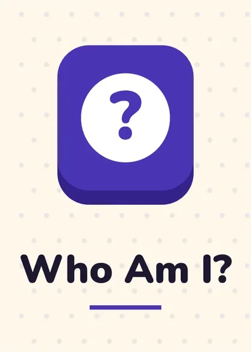
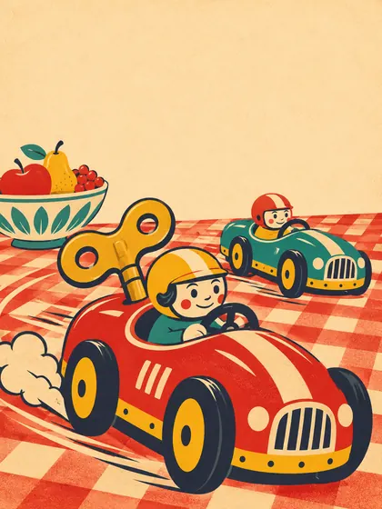
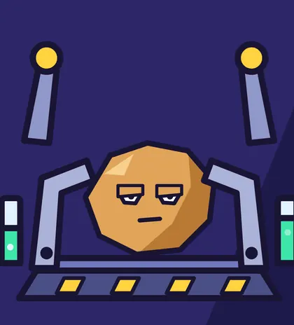

# n8 Party Games

Small party games for two to four people that share one room kit.
You open a room, friends join with a 4-digit PIN or a QR code, and everyone plays from their own phone or laptop.
Playing alone runs entirely in your browser.
Play it at https://partygames.n8builds.dev.

"n8 Party" is a working name.

## The games

This is the home of every n8games game: the ones made here each have a folder of their own under [`games/`](games), and two have repositories of their own.

<table>
<tr>
<td width="120"></td>
<td>
<b><a href="https://github.com/n8watkins/cork-and-bell">Cork &amp; Bell</a></b> (its own repository) - a 1930s fairground cork-gun shooting gallery at dusk.
Play one stall alone in the browser, or a battle of two to four stalls in the party room's Floor, each player on their own phone.
</td>
</tr>
<tr>
<td width="120"></td>
<td>
<b><a href="https://github.com/n8watkins/who-am-i">Who Am I?</a></b> (its own repository, with its Table version in <a href="games/who-am-i"><code>games/who-am-i</code></a>) - each of two players is dealt a secret name, asks yes or no questions and guesses who they are.
It is played at the Table, each player on their own phone.
</td>
</tr>
<tr>
<td width="120"></td>
<td>
<b><a href="games/tin-derby">Tin Derby</a></b> - wind-up tin cars race two laps round a breakfast table.
Up to four players steer on their own phones in the party room's Floor, with a big screen showing the race if there is one, and house cars fill the empty seats.
</td>
</tr>
<tr>
<td width="120"></td>
<td>
<b><a href="games/paper-masks">Paper Masks</a></b> - everyone answers a prompt in secret, the table guesses who wrote each answer, and then the masks come off.
Three to eight players play it at the Table, each on their own phone, with a big screen watching if there is one.
</td>
</tr>
<tr>
<td width="120"></td>
<td>
<b><a href="games/hot-potato">Hot Potato</a></b> - a spoken word chain: say a word in the category before the potato bursts, and the next word starts with your last letter.
Two to eight players pass one phone or browser around, with no server at all.
</td>
</tr>
</table>

## What is here

This repository is four things: the party kit, the party room (the lobby), the in-house games, and the party site that puts them all together.

- [`party-kit/`](party-kit/README.md) - the rooms: PINs, seats, reconnects, bots that take over a dropped seat, and a budget that caps how much hosted time rooms may use. It runs on Cloudflare Workers and Durable Objects. Games take it from here as a dependency.
- [`lobby/`](lobby/README.md) - the party room: one room where up to four players vote for the next game by standing in its light, play it, and come back with points. A first playable version.
- [`games.js`](games.js), [`worker.js`](worker.js), [`site/`](site/index.html) and [`scripts/`](scripts/build-public.mjs) - the party site: one Worker that serves the front page, the party room and every hosted game beside the kit.
  The front page asks "How do you want to play?" and opens three doors: In the room (the Floor), Round the table (the Table, started at `/table/`) and Pass one device.
  What it calls playable comes from the production wall (`lobby/wall.js`), which the build copies to `/home-wall.js`; `site/test/home.test.js` keeps the two in step.
- [`games/`](games) - every game made in this repository, one self-contained folder each, with its own `package.json`, README and tests (each is an npm workspace).
  A game reaches the hub only through the kit's contract and the hub's package name (`n8-party-games/...`), never by a path into the hub.
  The folders do not decide the addresses: Tin Derby is served at `/tin-derby/`, the Table games' views at `/party/games/`, Hot Potato at `/one-device/hot-potato/` (behind the front page's Pass one device door) and its hearing test at `/lab/hot-potato/`, and `site/test/served-addresses.test.js` pins them.
- [`landing/`](landing/public/index.html) - a new front page that is waiting for approval. Only the local build serves it, at `/preview/landing/`; its pictures are made by the scripts in `landing/tools/`.
- [`party-kit/GAME-CONTRACT.md`](party-kit/GAME-CONTRACT.md) - what a game must export for the site to host it.
- [`DEPLOY.md`](DEPLOY.md) - the checklist for every deploy.

Cork & Bell is its own repository, installed here as a git dependency, and plays on its own from there too.
It is built with three.js and light baked in Blender.

Cork & Bell and Tin Derby hang on the party room's wall and are played inside the room: when one wins the vote it starts for the party's seats, and the places go on the Tonight board.
The wall's last frame is a poster asking for game ideas, which opens the contact form on n8builds.dev; it is not a game and has no light.
Paper Masks and Who Am I? are Table games, not on the Floor's wall: the host picks them from the Table's list.
Who Am I? also plays on its own site, from its own repository.
Coin Flip and Count to ten, placeholders marked as tests, hang only in local play and the test runs.

## Run it

```sh
npm install
npm run dev     # http://localhost:8791/ (the party room) and /cork-and-bell/ (the game on its own)
npm test
```

To try the party room on one laptop, open `http://localhost:8791/` in two browser windows, start a party in one and join with its code in the other.

Everything runs locally; no Cloudflare account is needed to play or develop.
See the kit's README for the other commands.

The games in `games/` are npm workspaces, linked into `node_modules/` by `npm install`, and share its one copy of every tool.
So is this repository itself (`node_modules/n8-party-games`), which is how a game imports the kit by name, and so is the party room's `lobby/` (`node_modules/@n8games/lobby`, private), which is how a game's tests reach the room and the in-house test helpers.
Cork & Bell is a git dependency, pinned in `package.json`.
npm 12 refuses those unless told otherwise, so [`.npmrc`](.npmrc) sets `allow-git=root`: the git dependencies this package names itself are allowed, and no others.
While a game's repository is private, `npm install` also needs a GitHub login that can read it.

## How a game gets in

A game is a folder of its own under `games/` (a workspace package), or installed as a development dependency, and listed in `games.js`.
The build copies the files its manifest names from its package's folder to the game's path on the site, and the Worker takes its server definition for the rooms.
The game never carries its own copy of the kit: its server code names none, and its page loads the kit's browser files from `/party-kit/client/` on whichever site serves it.
The game in turn takes the kit from this repository as a development dependency, so neither install pulls in the other's.

## What it costs to host

Static files and solo play cost nothing.
Only rooms use paid compute, and only while they are awake.
A game's own room is awake while a round is being played and sleeps in between.
The party room is awake for the instant each move takes to pass on, and for the few seconds a game is played; a lobby nobody touches is asleep.
The room budget in the party kit closes rooms for the day or month once a set share of the plan's allowance is used.
The details are in the [party kit README](party-kit/README.md), and the party room's measured numbers are in the [lobby README](lobby/README.md).

## Credit

[](https://www.youtube.com/@nicksaraev)
[](https://www.youtube.com/watch?v=wpFw66kKixU)
[](https://www.youtube.com/watch?v=5mA9Hab09Do)
[](https://www.skool.com/maker-zero/about)

The party games started from build prompts by Nick Saraev, published with two of his Claude Fable 5.2 videos.
Each of his prompts is a single-player build; each game here takes one and remakes it for friends playing together on their phones.

| Game | Nick's prompt | From his video | State |
| --- | --- | --- | --- |
| [Cork & Bell](https://github.com/n8watkins/cork-and-bell) | The cork gallery | [I Threw $1000 at Fable 5.2 to Build The Coolest Demos Possible](https://www.youtube.com/watch?v=wpFw66kKixU) | Built |
| Flood | The tile river | [I Threw $1000 at Fable 5.2 to Build The Coolest Demos Possible](https://www.youtube.com/watch?v=wpFw66kKixU) | Planned |
| Bathtub Regatta ([Tin Derby](games/tin-derby) on the party room's wall) | Wind-up derby | [13 INSANE Things You Can Build w/ Claude Fable 5.2](https://www.youtube.com/watch?v=5mA9Hab09Do) | Built |
| Fox Trouble | The fox knight, loosely | [13 INSANE Things You Can Build w/ Claude Fable 5.2](https://www.youtube.com/watch?v=5mA9Hab09Do) | Planned |

Where to find Nick:

- YouTube: [@nicksaraev](https://www.youtube.com/@nicksaraev)
- [Maker Zero](https://www.skool.com/maker-zero/about), his free community on Skool.
  Nick's prompt pack for each of the two videos is free there; both videos' descriptions send you there for it.
- [Maker School](https://www.skool.com/makerschool/about), his paid community on Skool.

The text of the four prompts in the table is kept unchanged in [`credits/nick-saraev/`](credits/nick-saraev/README.md), with where it came from and where to get his full prompt packs.
The MIT License here covers this project's own code and assets, apart from the exceptions under License; Nick's prompts and any wording taken from them remain his and are not licensed by this repository.
This project is not affiliated with Nick Saraev or endorsed by him.

## License

The code is under the [MIT License](LICENSE).
Each game carries its own license and the licenses of what it includes.
Nick Saraev's prompts, and any wording taken from them, are his and not under the MIT License, including the four prompts in `credits/nick-saraev/` (see [Credit](#credit)).

The front page's two fonts (`site/fonts/`, Baloo 2 and Nunito) are not under the MIT License: they are under the SIL Open Font License 1.1, whose text is beside each of them.

The party room's sounds (`lobby/public/sounds/*.mp3`) are not under the MIT License.
Every one of them was made from a recording released under Creative Commons Zero (CC0 1.0, public domain).
Most of the room's own sounds come from Kenney's Impact Sounds, Interface Sounds, Casino Audio and RPG Audio packs (kenney.nl).
The emote sounds, and a few room sounds, come from single recordings on Freesound by sammy214, semccab, schots, SpliceSound, DavidJGurney, tonmayster, Streety, dr_skitz, Breviceps, connerdrake98, DeezSoundzTho, esperar, keweldog, kaydinhamby, qubodup, Raventhornn, simkiott, skymary and florianreichelt.
[`lobby/public/sounds/CREDITS.txt`](lobby/public/sounds/CREDITS.txt) names the recording behind each file, with its page, and [`preview/recordings/sources.json`](preview/recordings/sources.json) keeps the full source record (title, author, page, licence as read on the page, and the date it was read).
`preview/recordings/ship.mjs` remakes the files from those recordings.
